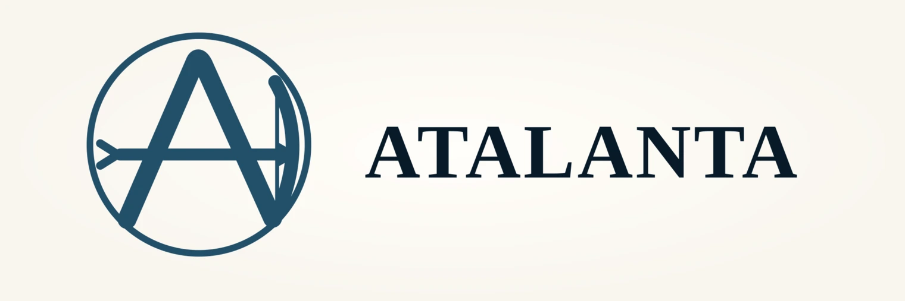
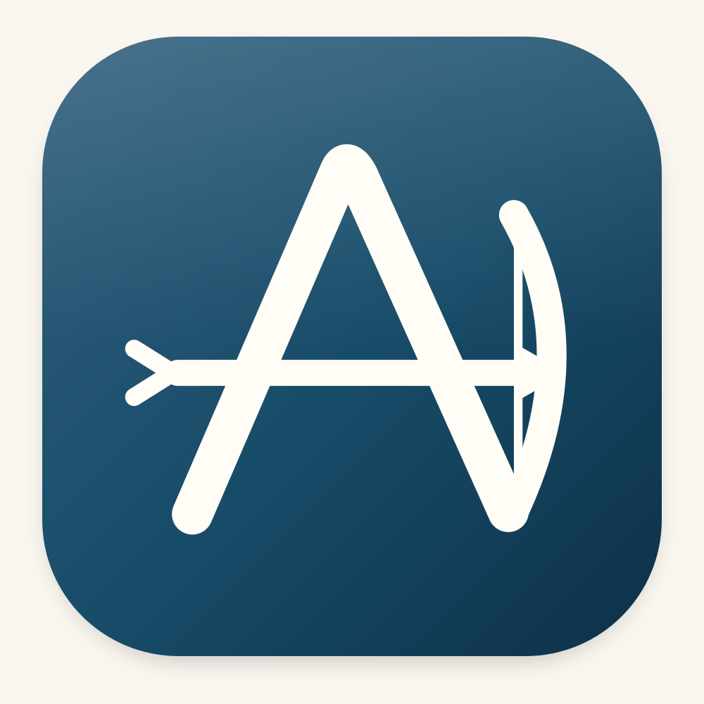
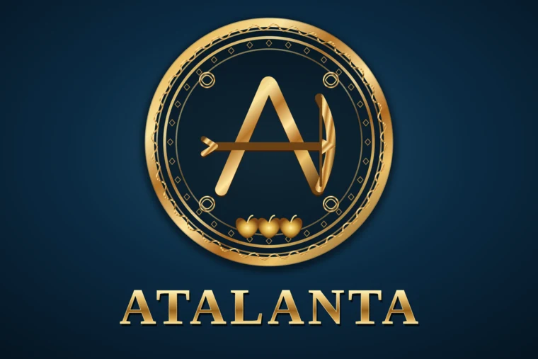

  

# Atalanta

**Atalanta** is the planned Java member of the Black Belt Badger Alpaca client family, alongside [Kirke](https://github.com/black-belt-badger/kirke) (Haskell) and [Medea](https://github.com/black-belt-badger/medea) (Rust).

**Current status: artwork only.** This repository does not yet contain a Java library, CLI, published package, or Alpaca integration. The implementation and its public API will be designed after learning from the other two projects.

## Artwork

Four coordinated variants inspired by Atalanta's bow, arrow, and golden apples:

| Color icon | Monochrome icon |
|:--:|:--:|
|  |  |

**Fancy wordmark:** [view PNG](docs/fancy.png) · [download SVG source](docs/fancy.svg) · [web-optimized WebP](docs/fancy.webp)

**Ornate emblem:**

All four designs have editable/scalable SVG sources and PNG exports in [`docs/`](docs/):

- [Color SVG](docs/color.svg) · [Color PNG](docs/color.png)
- [Monochrome SVG](docs/monochrome.svg) · [Monochrome PNG](docs/monochrome.png)
- [Fancy SVG](docs/fancy.svg) · [Fancy PNG](docs/fancy.png)
- [Ornate SVG](docs/ornate.svg) · [Ornate PNG](docs/ornate.png)

The README uses small WebP images where appropriate, while preserving full-resolution artwork.

---

Atalanta is an independent, unofficial future project and is not affiliated with Alpaca Markets.
